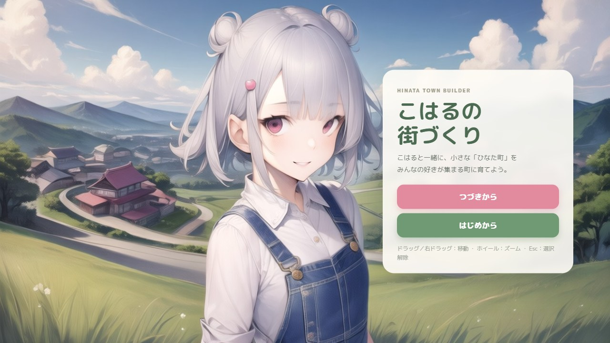
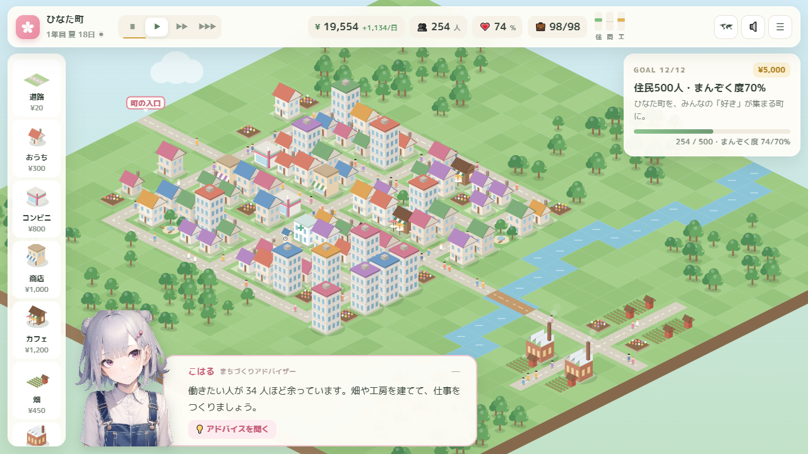
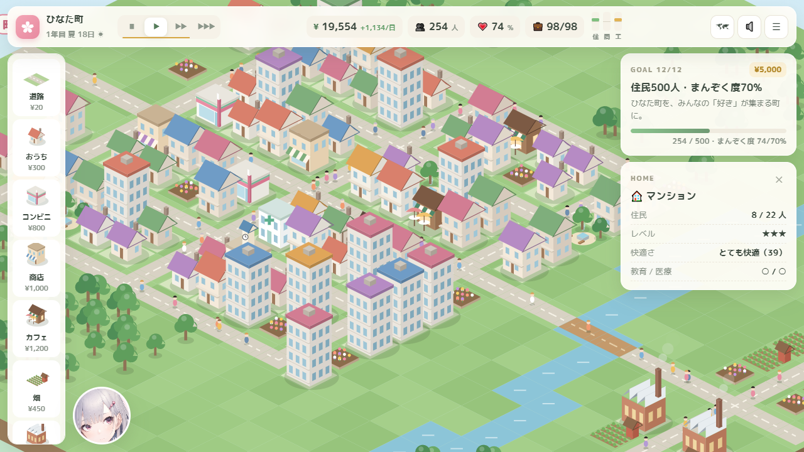
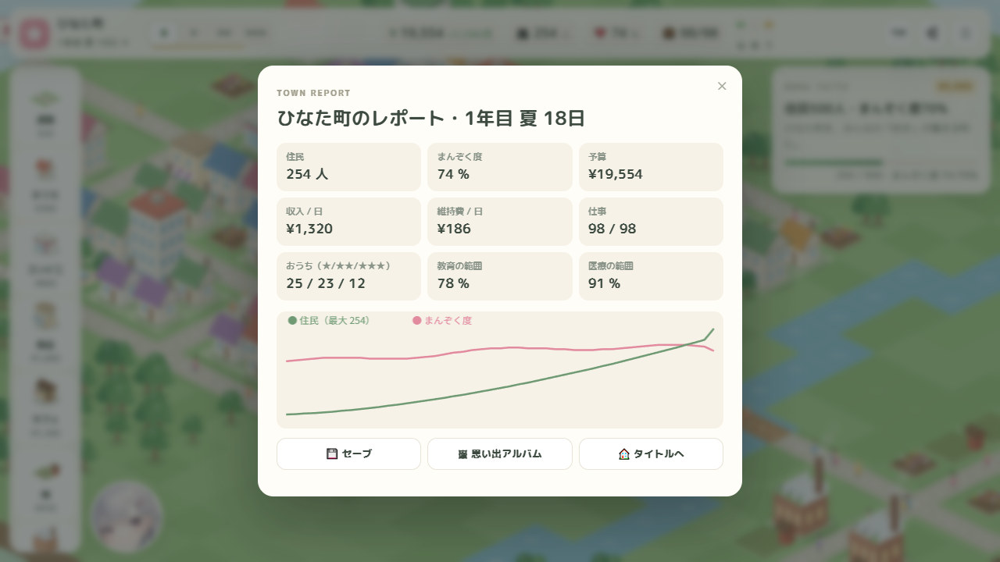
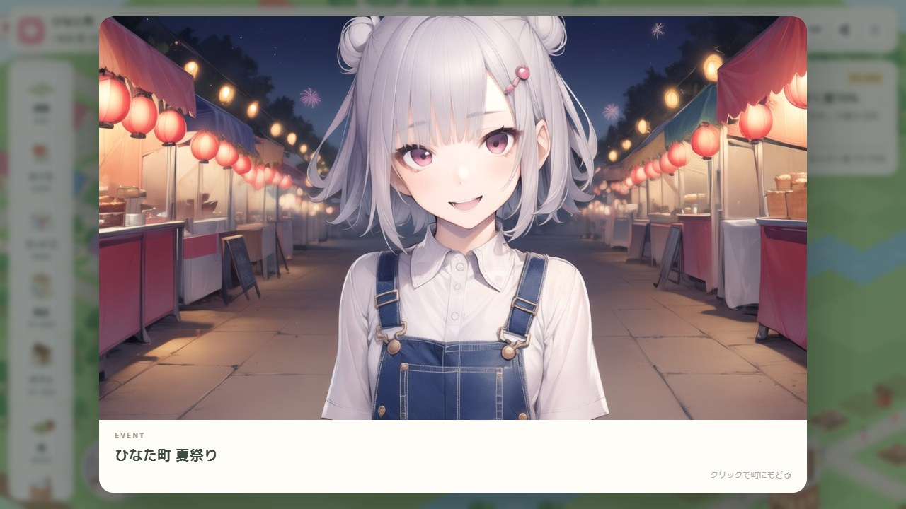
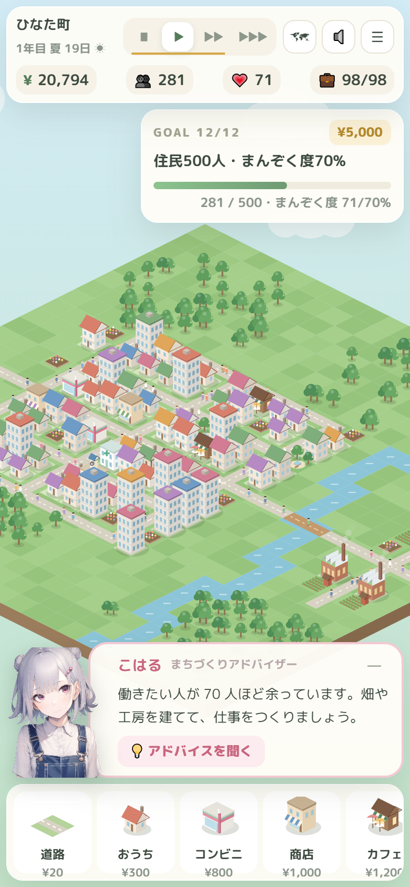

# こはるの街づくり

こはると一緒に「ひなた町」を育てる、ブラウザーで遊べる街づくりシミュレーションです。





| 建物を拡大して確認 | 町のレポート |
| --- | --- |
|  |  |
| **イベントCG** | **スマホ表示** |
|  |  |

## 特徴

- 道路でつながった建物だけが動く、アイソメトリック表示の街づくり（建物12種）
- おうちは快適さ・お店・学校の条件がそろうと二階建て→マンションに成長
- こはるが目標を案内し、「アドバイスを聞く」で町の課題を教えてくれる
- 全12個の目標と、節目で見られるイベントCG（思い出アルバムに保存）
- 季節・天気・観光客・お祭り、レポートのグラフ、自動セーブ、スマホ対応
- こはるの立ち絵（表情6種）とCGは ComfyUI＋LoRA で生成

## 起動

このフォルダーで次を実行し、`http://127.0.0.1:8192/` を開きます（`index.html` を直接開いても遊べます）。

```powershell
python -m http.server 8192 --bind 127.0.0.1
```

## 遊び方

- 左のメニューから建物を選び、マップをクリックして建てます。道路とこわすツールはドラッグでまとめて使えます。
- 建物は「町の入口」とつながった道路に面していないと使えません（赤い「！」が出ます）。
- 右上の ▶ / ▶▶ / ▶▶▶ で時間が進みます。1日ごとに税金・お店の売上・工房の生産が入り、維持費が引かれます。
- おうちは「満員」「快適」「お店が近い」がそろうと二階建てに、さらに学校の範囲内ならマンションに育ちます。
- 「住・商・工」のバーは、町がいまほしがっているもの（住宅・お店・仕事）の目安です。
- 🗺 で快適さマップ（公園・カフェ・自然は＋、工房は−）を表示できます。
- こはるの「アドバイスを聞く」で、いまの町の課題を教えてもらえます。
- 目標は全12個。達成するとごほうびと新しい建物、イベントCGが解放されます。セーブは自動（メニューからも可能）。

| 操作 | キー |
| --- | --- |
| 移動 | ドラッグ（建設中は右ドラッグ）／WASD・矢印キー |
| ズーム | マウスホイール／ピンチ |
| 一時停止・速さ | Space・P ／ 1・2・3 |
| 道路・こわす | R ／ B |
| 選択解除 | Esc |

## ファイル構成

- `index.html` / `styles.css` … 画面
- `js/data.js` … 建物・目標・こはるのセリフ
- `js/sim.js` … 町のシミュレーション（道路の接続、快適さ、住民・仕事・お店、おうちの成長）
- `js/render.js` … アイソメトリック描画（建物はすべて Canvas で描画）
- `js/main.js` … 入力・会話・目標・セーブ
- `assets/koharu/` … こはるの立ち絵（表情6種、背景透過）
- `assets/cg/` … タイトル・イベント用CG
- `tools/gen_assets.py` … ComfyUI で立ち絵・CGを生成するスクリプト
- `docs/screenshots/` … README 用のスクリーンショット

## こはるの画像（ComfyUI）

`tools/gen_assets.py` で ComfyUI（`http://127.0.0.1:8189`）から生成しています。設定は既存のこはる生成と同じです。

- モデル：`Anima-Base-v1.0` ＋ CLIP `qwen_3_06b_base` ＋ VAE `qwen_image_vae`
- LoRA：`Koharu-Koharu-epoch100`（0.8）→ `anima-style-epoch35-lr5e5`（0.8）
- euler / simple / 24 steps / CFG 4.5、プロンプトの先頭は `koharu_rikka, anima_style`
- 立ち絵は `birefnet` で背景を抜いて透過PNGにしています

```powershell
python tools/gen_assets.py            # 全部作り直す
python tools/gen_assets.py happy wink # 指定したものだけ
```

シードは `SPECS` に固定してあるので、気に入らない表情はシードを変えて再生成してください。ComfyUI 側の出力は `output/town_game/` に保存されます。
